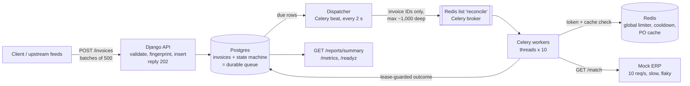
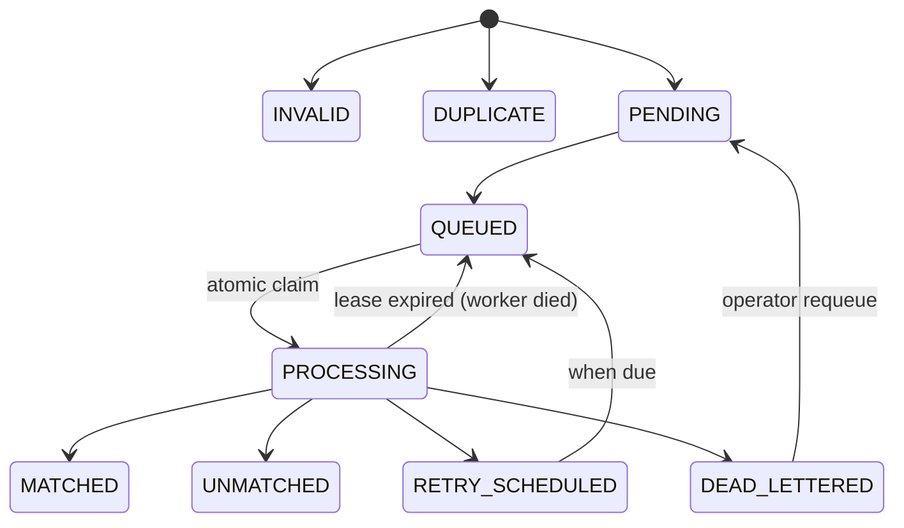

# DESIGN.md — Invoice Ingestion & Reconciliation Pipeline

**In one paragraph:** invoices are written to Postgres the moment they arrive, and Postgres
stays the single source of truth for each invoice's state. Redis carries only invoice IDs to
workers, enforces one global ERP rate limit, and caches what we learn about purchase orders.
Each invoice may be *worked on* more than once (crashes, retries), but database constraints
make sure its *outcome* is recorded exactly once. The ERP's 10 requests/second limit is the
ceiling on throughput, so the design accepts bursts cheaply, lets the backlog wait in Postgres,
and drains it at the ERP's pace.

---

## 0. Assumptions

| # | Assumption | Why it matters |
|---|---|---|
| A1 | `invoice_id` is the upstream's stable ID for one submission. Re-sending the same invoice re-uses it. | Our first idempotency key. |
| A2 | Two invoices with the same vendor, PO, amount, currency and `invoice_number` are the same bill, even with different IDs. | Our second idempotency key (the "fingerprint"). |
| A3 | The ERP match endpoint is read-only, so calling it twice is harmless. | Lets us retry freely. |
| A4 | Amounts have 2 decimal places. We store them as `numeric(14,2)`, never float. | Exact fingerprints and tolerance checks. |
| A5 | **The provided harness matches only ~0.08% of invoices** (75 of 100k with seed 42), not the ~81% its README suggests. The generator and the ERP draw vendors and amounts from different random streams. We did not change the harness. Tests use their own fixtures for the matching rule. | Explains the low match rate in our demo. |
| A6 | **The ERP does not check currency.** 37 of those 75 "matches" are in a different currency from the PO. We reject them locally as `currency_mismatch`. | Avoids paying a EUR invoice against a USD PO. |
| A7 | Authentication and multi-tenancy are out of scope for the slice (section 9). | |

---

## 1. Architecture

**Boundaries.** The API never calls the ERP and never talks to Celery. Workers never decide
*what* to process: they only act on what the dispatcher hands them, and only after an atomic
claim. All business decisions (validation, classification, matching) are pure functions in
`services/`, tested without HTTP, Celery or Redis.

### Life of one invoice

1. **Ingest.** The API validates the record and computes our own fingerprint. It inserts the
   row with `ON CONFLICT (invoice_id) DO NOTHING`. The result is `PENDING`, `INVALID` or
   `DUPLICATE`, or nothing if the ID was already seen. It replies `202`. Cost: one insert.
2. **Dispatch.** Every 2 s the dispatcher selects due rows with `FOR UPDATE SKIP LOCKED`
   (new rows, retries whose time has come, expired leases). It marks them `QUEUED` and pushes
   their IDs to Redis, but only while the Redis queue has room.
3. **Claim.** A worker runs `UPDATE … SET status='PROCESSING', lease_token=<uuid>,
   lease_until=now()+60s WHERE id=? AND status='QUEUED'`. Only one worker can win.
4. **Cache check.** If cached facts about the PO already prove a mismatch, record `UNMATCHED`
   without calling the ERP. The cache can never approve an invoice.
5. **Rate limit.** Take a slot from the global Redis limiter (8 per clock second).
6. **ERP call** with a 2.5 s read timeout. A pure `classify()` function turns the result into
   MATCHED, UNMATCHED, RATE_LIMITED, TRANSIENT or PERMANENT.
7. **Record.** Write the final status and a `reconciliation_result` row
   (`UNIQUE(invoice_id)`), guarded by `WHERE lease_token = <mine>`. Or reschedule as
   `RETRY_SCHEDULED` with a `next_attempt_at`, or dead-letter. Counter tables are updated in
   the same transaction.

### State machine

---

## 2. Scaling to production volume

### The bottleneck is the ERP, and nothing else comes close

| Stage | Capacity | Load at a 4,000/min burst |
|---|---|---|
| Ingest (one insert per invoice, 4 gunicorn workers) | thousands/s | 67/s |
| Postgres writes (~3 per invoice) | thousands/s | ~200/s |
| Redis (limiter, broker, cache) | 50k+ ops/s | < 1k/s |
| **ERP** | **8/s** (we keep 2 of the 10 as headroom) | 67/s wanted |

**Steady-state ceiling:** 8 calls/s, minus ~6% wasted on 503s and timeouts ≈ **7.5 useful
calls/s ≈ 450/min ≈ 650k/day**, *before* cache savings. Normal traffic is 50/min (11% of
capacity). Growth of 300k/month is ~10k/day, about 1.5% of daily capacity. So the system is
idle most of the day and only works hard during batch dumps.

### What happens in a burst

Assume a daily dump of 4,000/min for 15 minutes = 60,000 invoices.

- **Ingest keeps up easily.** 67 inserts/s is trivial for Postgres; the API replies `202` in
  milliseconds.
- **The backlog lives in Postgres**, as `PENDING` rows, not in Redis memory. The Redis queue
  never holds more than `QUEUE_HIGH_WATER` (1,000) IDs. That is ~2 minutes of work, well
  inside the 5-minute queue lease.
- **Backlog peak:** 60,000 in − ~6,750 processed = **~53,000 waiting** at the end of the burst.
- **Drain time:** ~53,000 / ~6.7 net per second (7.5 out − 0.8 steady inflow) ≈ **2.2 hours**,
  less whatever the PO cache answers locally. In the sample data the cache can decide a large
  share of mismatches, because 91k lookups hit only 35.6k distinct POs.
- **Hard limit:** above 200,000 waiting rows (~7 hours of ERP time) the API returns `429` with
  `Retry-After`. The upstream is at-least-once and will retry; we would rather push back than
  accept work we cannot finish in a day.

### Measured on the slice (Docker, ERP chaos on)

| Run | Result |
|---|---|
| 3,000 invoices | every row final; **0 ERP 429s**; never more than 8 calls started in one second |
| PO cache | decided **1,535 of 2,730** reconciliations (56%) without an ERP call; 1,251 ERP calls in total; same final outcomes as a run without the cache |
| One worker, 10 threads | 7.97 ERP calls/s with `prefetch_multiplier=2` (5.9/s with 1, see section 8) |
| Burst, 4,000/min for 1 min | all `202`, ingest p95 374 ms; backlog in Postgres, Redis queue ≤ ~1,000 |

### Workers and partitioning

- By Little's law, 8 calls/s × ~0.55 s average latency ≈ 4.4 calls in flight. Timeouts
  (2.5 s) and limiter waits push that up, so we run **10 threads per worker process**. Threads
  are right here because the work is waiting on I/O.
- **Two worker containers** (20 threads) give availability, not throughput. Adding workers
  beyond that does **not** raise throughput, because the ERP limit is global. Our limiter is
  global too, so extra workers simply wait.
- **No partitioning is needed for throughput.** For **fairness**, the production version would
  give each `source` its own dispatcher quota (weighted round-robin in the dispatcher query),
  so one noisy bank feed cannot starve the property ERP feed. New invoices could also be
  prioritised over a historical backfill. The slice does not build this (section 9).

### 12M+ rows

- **Partial indexes** cover only *unfinished* rows (dispatcher, stuck query). Their size
  depends on the backlog, not the table, so they stay small at 12M or 120M rows.
- **Partition `invoice` by month** of `created_at` in production. One catch: a unique index
  on a partitioned table must include the partition key, so `UNIQUE(invoice_id)` and the
  fingerprint index cannot be global. The production design moves both keys into a narrow,
  unpartitioned **`invoice_key(invoice_id PK, fingerprint UNIQUE)`** table (~100 bytes × 12M
  ≈ 1.2 GB). The wide rows (raw JSON, results) live in monthly partitions that can be archived.
- Historical invoices are already final, so they are never re-reconciled.

### If the ERP limit is the business problem

More hardware will not help. The real levers, in order: (1) a higher cache hit rate,
(2) asking the ERP owner for a **bulk PO export** or a batch match endpoint (one call for 100
POs would change the ceiling 100×), (3) a higher rate-limit agreement, (4) doing the
deterministic part of the matching rule locally from a nightly PO snapshot, and calling the
ERP only to confirm.

### Proposed production queue

Keep the Postgres state machine; it is what makes correctness easy to reason about. The Redis
delivery channel could be swapped for SQS (standard queue, visibility timeout = lease) without
changing semantics, because the queue is already treated as "at-least-once delivery of hints".
Kafka would only be worth it if several other systems needed to consume invoice events.

---

## 3. Delivery and correctness semantics

**Guarantee: at-least-once execution, exactly-once outcome.**

| Layer | Mechanism | What it stops |
|---|---|---|
| Ingest | `UNIQUE(invoice_id)` + `INSERT … ON CONFLICT (invoice_id) DO NOTHING` | The same submission sent twice, including concurrently. The database serialises the race. |
| Ingest | Server-computed `fingerprint` with a partial unique index (one original per fingerprint) | The same bill under a new ID. The second row is stored as `DUPLICATE` → `duplicate_of`. It is kept for audit, never processed. |
| Processing | Atomic claim (`WHERE status='QUEUED'`) | Two workers starting the same invoice. |
| Outcome | Final write `WHERE lease_token = <mine>` + `UNIQUE` on `reconciliation_result.invoice_id` | A slow worker whose lease expired overwriting the newer outcome. A second result row. |

**Why not "true" exactly-once?** The ERP call and our database write cannot share a
transaction. A worker can call the ERP and then crash before committing. The lease expires,
another worker calls the ERP again, and that is fine because the call is a read (A3). We make
the *effect* idempotent instead of the *execution*.

**An invoice cannot be lost after `202`**, because the row is committed before we reply.
Before `202`, the upstream's at-least-once retry covers us. A Redis message can be lost (Redis
restart, worker crash after ack), but the row is still `QUEUED`/`PROCESSING` with a lease, and
the dispatcher re-sends it when the lease expires.

**Where a duplicate or a gap could still slip through (stated honestly):**

1. **Fuzzy duplicates.** The fingerprint is exact. `"1003-48217"` and `"1003 48217"`, or an
   amount re-typed with a rounding difference, are different fingerprints. Production fix:
   normalise `invoice_number` (strip punctuation, case), plus a fuzzy "possible duplicate"
   review queue keyed on `(vendor_id, normalised invoice_number)`.
2. **Corrected re-submissions.** If an invoice arrives malformed (`INVALID`) and the sender
   fixes it but re-uses the same `invoice_id`, we treat it as already seen. Production fix: an
   explicit "replace INVALID" path, or require a new ID.
3. **Over-billing a PO.** Ten different, valid invoices can each match the same PO and
   together exceed its value. Neither the ERP's rule nor ours tracks how much of a PO is used.
   This is the biggest *business* gap; see section 9.
4. **Payment side.** The payment batcher (not built) must use `reconciliation_result.invoice_id`
   as its own idempotency key. Our guarantee ends at "one MATCHED record per invoice".

**Clocks.** Leases use Postgres `now()` (one clock). The limiter uses Redis `TIME` (one
clock). The ERP counts on its own clock, so the windows may be misaligned. The 2-call headroom
plus the shared 429 cooldown absorb that.

---

## 4. Failure modes

| Scenario | What happens | Self-heals? | Pages a human? |
|---|---|---|---|
| **ERP down for an hour** | Calls fail with 503s, timeouts or connection errors. After 20 failures in a row, *breaker-lite* sets the shared cooldown for 30 s, so all workers pause and then send a few probes. Only ~20 invoices per 30 s use up a retry attempt, instead of 8/s. Some invoices still reach 6 attempts and are dead-lettered with reason `max_attempts`. Ingest keeps accepting. | Mostly. Backlog drains when the ERP returns. Dead-lettered ones need `requeue_dead_letters --reason max_attempts --since 2h`. | Yes: ERP error ratio alert and breaker-open alert. |
| **ERP slow** (latency near 2.5 s) | Throughput per thread drops (10 threads / 2.5 s = 4/s). The limiter is no longer the bottleneck; the thread count is. | Yes, at lower speed. | Only via backlog age. Fix: raise `--concurrency`. |
| **Redis restarts** | Queued messages are lost. Rows stay `QUEUED` and are re-dispatched when their 5-min queue lease expires. Limiter counters reset (at worst one extra burst of ≤8). Cooldown and PO cache are lost (more ERP calls for a while). Nothing in Postgres is affected. | Yes, within ~5 min. | Only if `/readyz` fails for > 2 min. |
| **Postgres down** | `/readyz` fails, ingest returns 5xx, and the upstream retries. Workers cannot claim; their tasks fail and are acked, and the rows are re-dispatched later by lease. | Yes, when Postgres returns. | Yes. |
| **Worker dies mid-invoice** | Its lease (60 s) expires. The dispatcher sets the row back to `QUEUED` and adds 1 to `crash_count`. Celery also re-delivers the message (`acks_late`), but that claim is a no-op because the row is no longer `QUEUED`. If the dead worker had committed, the row is final and nothing happens. | Yes. | No. |
| **Worker alive but stalled past its lease** | Another worker takes the invoice. The stalled worker's final write matches 0 rows (`lease_lost` log) and is discarded. | Yes. | No. |
| **Poison message** (crashes the worker every time) | `crash_count` reaches 3 → `DEAD_LETTERED`, reason `poison`. An ordinary Python exception (a bug) is caught, counted as a transient attempt with reason `internal_error`, and dead-lettered after 6. | Contained, not fixed. | Yes: dead-letter rate alert. |
| **Dispatcher (beat) dies** | Nothing new is dispatched; backlog grows. Compose/K8s restarts it. A Redis lock stops two dispatchers running at once after a restart. | Yes, with a restart policy. | Yes, if oldest-pending age > 30 min. |
| **Hot PO** (hundreds of invoices for one PO at once) | One worker takes `po:lock:{po}` and calls the ERP; the others reschedule for 2 s and then hit the cache. | Yes. | No. |
| **Reporting degrades** | Counts come from small counter tables (O(1)); stuck rows come from a partial index; responses are cached for 5 s. If the counter tables ever drift, a nightly job (designed, not built) recomputes them from `invoice`. | Yes. | No. A ticket, not a page. |

---

## 5. Caching strategy and invalidation

**Rule: the cache can say no; only the ERP can say yes.** A stale entry can therefore cause, at
worst, a wrongly **rejected** invoice (recoverable by re-checking `UNMATCHED`), never a wrong
**payment**.

**Why not cache ERP responses by request?** In the sample, every one of the 91,393 lookups has
a different `(po, vendor, amount, currency)`, so that cache would get 0 hits. What repeats is
the **PO**: 35,614 distinct POs.

**What we cache.** The ERP has no "get PO" endpoint, but its answers reveal facts about the PO.
We store them per PO in a Redis hash `po:{po_number}`:

| ERP answer | Fact learned | TTL |
|---|---|---|
| `matched: true` | vendor, amount, currency, status | 15 min |
| `vendor_mismatch` | the correct vendor (`expected_vendor`) | 15 min |
| `amount_out_of_tolerance` | the PO amount, and that our vendor was correct | 15 min |
| `po_not_found` | the PO does not exist | 2 min |

Before calling the ERP, the worker checks: known vendor and ours differs → `UNMATCHED`; known
amount and ours is outside 1% → `UNMATCHED`; known missing → `UNMATCHED`. If everything still
looks consistent, **we call the ERP**. Results decided from the cache are marked
`decided_by='cache'` for audit.

**Staleness.**
- *PO amended within the TTL* (amount raised, vendor reassigned). We might wrongly reject an
  invoice for up to 15 min. The cost is a false `UNMATCHED`, not a false payment.
- *PO created after a `po_not_found`.* This is the most likely staleness in practice, so it
  gets the shortest TTL (2 min).
- *PO closed or fully billed after a match.* The cache never approves, so it cannot cause this.
- Production: if the ERP can emit PO-change events (webhooks, CDC), delete `po:{po}` on change
  and the TTLs become a safety net.

**Hot keys.** A lock (`SET po:lock:{po} NX PX 5000`) makes sure only one worker asks the ERP
about an unknown PO. The others wait 2 s and read the cache.

**Measured:** on the 3,000-invoice sample (1,000 POs) the cache decided 56% of
reconciliations locally, and the final outcomes were identical to a run without the cache.
Hit rate depends on how often a PO repeats within the 15-minute TTL; at 12M invoices over
many more POs it will be lower, which is why the ERP rate, not the cache, sets the ceiling.

**Memory and eviction.** ~200 bytes × active POs. In production the cache needs
`maxmemory-policy allkeys-lru`, but the **broker must never be evicted**. A Redis database
number cannot have its own eviction policy, so production runs the cache on a **separate Redis
instance** from the broker and limiter (`noeviction`).

---

## 6. Reporting at scale

`GET /reports/summary` returns counts by status, the match rate over a time window, the stuck
backlog with reasons, queue depth, and dead letters by reason.

| Question | Source | Cost at 12M rows |
|---|---|---|
| Counts by status | `status_count` table, updated (+1/−1) in the same transaction as each status change | 9 rows |
| Match rate this hour / last N hours | `outcome_hourly(hour, outcome, count)`, +1 on each final outcome | ≤ 24 × 5 rows per day of window |
| What is stuck and why | `WHERE updated_at < now() − 10 min` on a **partial index of unfinished rows**; returns the 20 oldest with `last_error` | proportional to the backlog, not the table |
| Dead letters by reason | partial index on `DEAD_LETTERED` | proportional to the DLQ |

The whole response is cached in Redis for 5 s, so a dashboard refreshing every second cannot
load the database.

**Why counters in the write transaction, not `COUNT(*)` or a materialised view?** They are
exact, they cost one extra small write per transition, and they are always current.
`COUNT(*) GROUP BY status` is fine at 100k rows but not at 12M. A materialised view is stale
between refreshes, and refreshing it is the same expensive scan.

**What breaks next, and the fix.** At much higher write rates, `status_count` becomes a hot row
(every transaction updates the same few rows). Fix: shard the counter (`(status, shard 0–15)`,
sum on read), or move live counts to Redis `INCR` with a periodic reconcile from Postgres.
Analytics beyond operations (match rate by vendor or source over months) belong on a **read
replica** or an **OLAP store** (ClickHouse/BigQuery fed by CDC), not on the primary.

---

## 7. Observability and on-call

**Correlation.** The API takes `X-Request-ID` (or creates one) as the `trace_id`. It is stored
on the invoice row, passed in Celery task headers, and sent to the ERP. Every JSON log line
carries `trace_id` and `invoice_id`, so one `grep` shows an invoice's whole story: received →
dispatched → claimed → erp.call (status, ms) → outcome.

**Metrics** (`/metrics` on the API; the worker exposes its own on :9101): ingest by result,
outcomes by status and reason, ERP latency histogram, ERP responses by code, retries and dead
letters by reason, cache lookups (decided / undecided / miss), limiter wait time, breaker
openings, queue depth, and backlog by status.

**Health.** `/healthz` = the process is alive. `/readyz` = Postgres and Redis respond.

### Queue lag: what happens and how we see it

**Lag lives in Postgres, not Redis.** The Redis list is capped at ~1,000 IDs (~2 minutes of
work). Any real backlog is unfinished rows in Postgres. When lag grows: ingest still returns
`202`, Redis memory stays flat, workers keep running at the ERP's 8/s, and nothing is lost.
Above 200k waiting rows, ingest returns `429` (backpressure to an upstream that already
retries).

**We measure lag in time, not count.** 50k waiting rows is normal mid-burst; an invoice that
has waited 3 hours is a problem at any backlog size. Key signals:
`oldest_unfinished_age_seconds`, `backlog{status}`, ingest rate vs completion rate, and
`estimated_drain_seconds` = backlog ÷ completion rate.

**Each cause has a different signature**, so the dashboard tells an operator what to do:

| What you see | Cause | Action |
|---|---|---|
| ERP calls flat at 8/s, high limiter wait, few errors | Normal burst: input above the ERP ceiling | None, if drain time is acceptable |
| High ERP error ratio, breaker opening | ERP unhealthy | Contact ERP owner; requeue dead letters after |
| ERP calls below 8/s, p95 latency near 2.5 s, no limiter wait | ERP slow; threads are the bottleneck | Raise worker concurrency |
| Redis queue stuck at 1,000, ERP calls at 0 | Workers down or stuck | Restart; leases recover in-flight rows |
| Redis queue at 0, `PENDING` growing | Dispatcher (beat) down | Restart beat |
| `RETRY_SCHEDULED` growing fast | Retries crowding out new work | Inspect error reasons |

### The five alerts that page

| Alert | Why this one |
|---|---|
| **Oldest unfinished invoice > 30 min, or estimated drain time > 4 h** | One alert that catches almost everything: dispatcher dead, workers down, ERP down, a stuck lease bug. It measures the user-visible symptom. We deliberately do **not** page on backlog size: it fires on every normal burst. |
| **Dead letters > 50 in 10 min** | Something is systematically failing (ERP outage, poison data, a bug). |
| **ERP error ratio > 20% for 5 min, or breaker open > 5 min** | The upstream is unhealthy; usually someone has to talk to the ERP owner. |
| **Sustained 429s > 1/s for 5 min** | Our limiter is wrong, or another system is using the same ERP quota. |
| **`/readyz` failing > 2 min** | Postgres or Redis is down. |

### The first dashboard: "What is the pipeline doing right now?"

Built as `monitoring/grafana/dashboards/pipeline.json` (`docker compose --profile monitoring
up -d`, then <http://localhost:3000>).

1. Ingest rate vs completion rate (two lines; the gap is the backlog growing).
2. Backlog by status (stacked) and **oldest-unfinished age** (single big number).
3. ERP calls/s by response code, with a line at the 8/s limit; p50/p95 ERP latency.
4. Limiter wait time and breaker openings.
5. Cache decided-rate (share of invoices answered without the ERP).
6. Dead letters by reason (table, last 24 h).

---

## 8. Tradeoffs

### Decision 1 — Postgres is the durable queue; Redis only delivers

- **Chose:** every invoice's state, retry time and lease live in Postgres. Redis/Celery carries
  only IDs, and a dispatcher refills it from Postgres.
- **Gained:** nothing is lost if Redis is wiped. "What is stuck and why" is a SQL query. The
  backlog can be millions of rows without Redis memory risk. Backpressure is natural (the
  dispatcher stops when the queue is full).
- **Gave up:** extra database load from the dispatcher (one indexed query every 2 s), up to 2 s
  extra latency per hop, and more moving parts than "just Celery".
- **Would revisit:** at much higher volume, swap the dispatcher's polling for
  `LISTEN/NOTIFY`, or replace the Redis channel with SQS.

### Decision 2 — Retries are rows, not Celery `countdown`/`eta`

- **Chose:** a retry sets `RETRY_SCHEDULED` + `next_attempt_at`, and the task finishes.
- **Gained:** with a Redis broker, delayed Celery tasks sit in worker memory and are
  **re-delivered** if the delay exceeds the visibility timeout. During an hour-long ERP outage
  that means thousands of tasks in RAM and duplicate deliveries. Rows avoid both, and retries
  are visible and queryable.
- **Gave up:** retry timing is accurate only to the dispatcher interval (2 s), and we wrote
  our own backoff instead of using Celery's.

### Decision 3 — "The cache can say no; only the ERP can say yes"

- **Chose:** cached PO facts can reject an invoice but never approve one.
- **Gained:** a stale cache can never cause a wrong payment, which is the failure the business
  cares about most. It also gives the cache a clear, testable invariant.
- **Gave up:** every real match still costs one ERP call. In a dataset with a high match rate,
  savings would come mostly from duplicate-PO mismatches.
- **Would revisit:** with ERP change events (CDC/webhooks) for invalidation, allow cached
  approvals for POs whose facts are seconds old.

### Smaller decisions

- **A limiter per clock second, not a token bucket:** it mirrors the ERP's own fixed window.
  A token bucket of 10 can legally send 19 calls inside one ERP second.
- **Limit 8, not 10:** headroom for clock skew and for timed-out calls the ERP still counted.
  This costs 20% of the ceiling; with a real ERP we would tune it from the observed 429 rate.
- **Threads, not processes, for workers:** the work is I/O waiting.
- **Prefetch 2, not 1:** measured in Docker, one 10-thread worker reached ~5.9 ERP calls/s
  with prefetch 1 (threads idle between ack and next fetch) and 7.97/s with prefetch 2. A dead
  worker's unstarted prefetched messages are harmless: their rows are re-dispatched by lease.
- **One insert per invoice with a savepoint, not bulk insert:** we need to know, per record,
  whether it was new, a duplicate or already seen. At 67/s this costs nothing.

---

## 9. Deliberately not built (and why)

| Not built | Why | What production needs |
|---|---|---|
| **PO budget tracking** | Not part of the stated match rule, and it needs ERP data we do not have (remaining PO balance). | A `po_consumption` ledger and a check that matched invoices do not exceed the PO amount, with row-level locking per PO. **This is the biggest real-world risk.** |
| **Auth / multi-tenancy** | Out of scope per the brief. | API keys or OAuth per source; `tenant_id` on every row and every Redis key; **one rate limiter per tenant's ERP**. |
| **Payment batching / outbox** | `MATCHED` is the finish line. | A transactional outbox from `reconciliation_result`, keyed by `invoice_id`. |
| **Per-source fairness / priority** | Single source of traffic in the slice. | Weighted per-source quotas in the dispatcher query. |
| **Full circuit breaker** | Breaker-lite (shared cooldown after 20 failures in a row) covers the outage case. | Half-open state, per-error thresholds, a metric for state. |
| **Fuzzy duplicate detection** | Exact fingerprint is defensible and testable in the time box. | Normalised invoice numbers + a "possible duplicate" review queue. |
| **Counter drift repair job** | Counters are updated transactionally, so drift requires a bug. | Nightly recompute from `invoice`, alert on difference. |
| **Alert rules** | The five alerts are specified in section 7; the slice ships the dashboard (`monitoring/`), not Alertmanager rules. | Prometheus alert rules for the five pages, routed to on-call. |
